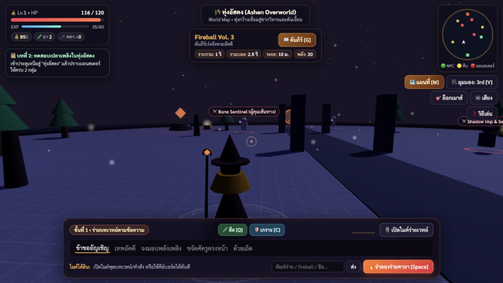

# Arcane Chant 3D

[Play the demo](https://zixma13.github.io/shortlist/arcane-chant-3d/) · [Download the HTML](index.html) · [Back to all demos](../README.md)

A 3D Voice-Spellcasting JRPG packed into a standalone single-file HTML experience. Explore **Ignis Village**, talk to NPCs for quests, buy potions & staff upgrades, open treasure chests, roam the **Ashen Overworld**, descend into the **Obsidian Catacombs** dungeon, and face **Malakor, the Crimson Dreadlord**—casting **Fireball Vol. 1 to Vol. 9**, **Heal**, and **Arcane Shield** with your voice.

## World & JRPG Systems

- **4 Interconnected 3D Zones**:
  1. **Ignis Village (`หมู่บ้านอัคคี`)**: Safe hub with Guild Tower, Arcane Fountain, cottages, 4 NPCs (Archmage Alduin, Merchant Elina, Innkeeper Brom, Scout Kaelen), 2 chests, and the North World Gate.
  2. **Ashen Overworld (`ทุ่งอัสดง`)**: Open twilight plains with ruin arches, crystal obelisks, 3 chests, Hermit NPC, and patrolling monster groups.
  3. **Obsidian Catacombs (`ดันเจี้ยนวิหารเพลิงทมิฬ`)**: Underground magma fissure halls, 3 chests, and dungeon guardians.
  4. **Dreadlord Sanctum (`โถงบัลลังก์จอมมาร`)**: Crimson throne chamber housing the final boss **Malakor**.
- **Seamless Encounter Battles**: Touch roaming enemies to warp into a 3D combat arena with staggered spawns, 10m/20m range rings, XP/Leveling, Gold rewards, and Tome drops.
- **Persistent Auto-Save**: Progress (`localStorage`) persists levels, gold, potions, opened chests, quests, and unlocked Fireball volumes.

## Controls & Requirements

- **Browser**: WebGL2 on `https://` or `localhost`. Voice recognition (`th-TH` + English `"fireball"`) uses **Web Speech API** (Chrome, Edge, Safari).
- **Weapons (Left-Click / Mobile Tap)**: Light weapons let you fight without losing your voice—**Fireblade** (`[1]`, 8 DMG melee slash) and **Crystal Crossbow** (`[2]`, 5 DMG ranged bolt). Flying enemies (**Sky Gargoyle**, `🪽 บินสูง`) cannot be reached by melee strikes and require ranged bolts or magic, while **Fireball** (`35–105 DMG`) triggers elemental fire weakness multipliers (`🔥 WEAK!`).
- **Movement & Camera**: `W A S D` or Arrow keys (plus on-screen **Mobile D-Pad** & Attack/Swap buttons on touchscreens) to move; drag mouse (or **Double-Click** canvas for pointer lock) to turn; `V` toggles 3rd-person / 1st-person staff view.
- **JRPG Keys & Settings (`⚙️` / `P`)**: `E` Interact (NPC / Chest / Portal) · `M` World Map Fast Travel · `G` Grimoire Codex · `Q` Heal Potion (`"ฮีล"`) · `C` Arcane Shield (`"เกราะเวทย์"`) · `R` Flee non-boss battle · **Tester Mode** (`Space` chant simulation & `⌨️` text input) and **Grimoire Vol. 1–9 Sandbox** are disabled by default and toggled inside `⚙️` Settings.

## Fireball Progression (Vol. 1 – Vol. 9)

| Volume | Incantation | Gather | Condense | Range | Damage |
| :--- | :--- | :---: | :---: | :---: | :---: |
| **Vol. 1** | Full Thai prayer (`ข้าขอสักการะเทพอัคคี...`) | 3.5s | 2.5s | 10m | 35 |
| **Vol. 2** | Shortened prayer | 3.5s | 2.5s | 10m | 35 |
| **Vol. 3** | Shortened prayer | **1.0s** | 2.5s | 10m | 35 |
| **Vol. 4** | Shortened prayer | 1.0s | **0s (Instant)** | **20m** | 35 |
| **Vol. 5** | **`ชาร์จพลังไฟ`** | 1.0s | 0s | 20m | 35 |
| **Vol. 6** | `ชาร์จพลังไฟ` | **0s (Instant)** | 0s | 20m | 35 |
| **Vol. 7** | **None (Silent Chant)** | 0s | 0s | 20m | 35 |
| **Vol. 8** | None | 0s | 0s | 20m | **53 (+50%)** |
| **Vol. 9** | None | 0s | 0s | 20m | **105 (+200%)** |

## Packaging & Credits

- Standalone single-file HTML (**944,487 bytes**, zero external runtime requests).
- Bundles **Three.js r170** (MIT License) with procedural textures, particles, and Web Audio API sound synthesis. See [THIRD_PARTY_NOTICES.md](THIRD_PARTY_NOTICES.md) and [LICENSE](LICENSE).

