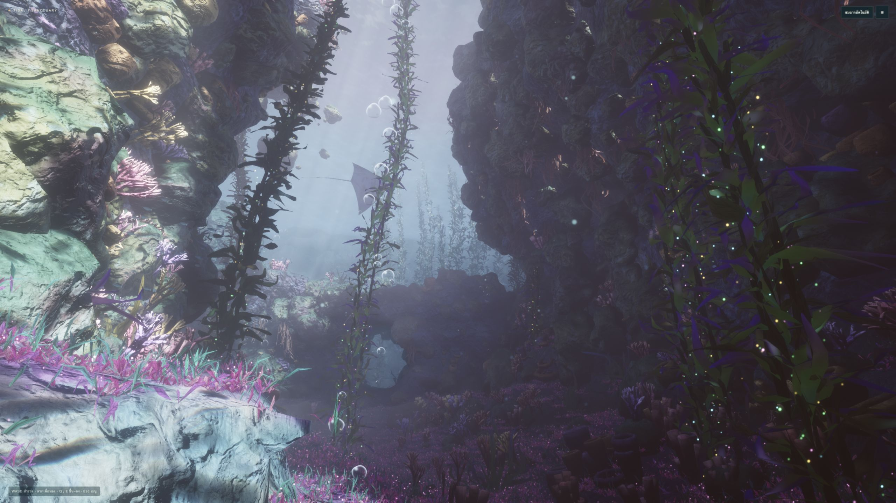

# Tidal Sanctuary

[Play the demo](https://zixma13.github.io/shortlist/tidal-sanctury/) · [Download the HTML](index.html) · [Back to all demos](../README.md)

A continuous procedural coast, kelp forest, shipwreck and luminous underwater grotto. Raw WebGPU/WGSL; all geometry, animation, textures and audio are generated in code. The published index.html is byte-identical to the visually reviewed lab build **d4237b7057ff**. The directory spelling `tidal-sanctury` is the requested public URL.

## Explore

Requires a browser with WebGPU, on HTTPS or localhost. Click **เข้าสำรวจอ่าว**, then drag to look. WASD moves, Q/E descends/ascends, Shift moves faster, Esc opens the menu. **ชมฉากอัตโนมัติ** or T runs the route; keys1–6 jump to its six places. H shows statistics, M toggles sound. Low/Medium/High selects detail.

## Size and measured performance

Complete HTML: **121116bytes**; gzip **47315bytes**; Brotli **41552bytes**. No external runtime dependencies or assets. Compressed sizes describe the bundled outputs, not a guarantee of GitHub Pages transfer encoding.

A60s route measured2026-11-17 on Apple M5 Pro/48GiB, macOS27.2.1, Codex in-app browser, WebGPU/Metal: **79.46FPS mean**, **16.70ms frame p95**, **11.46ms GPU mean**. Actual render resolution2560×1440, High/detail1/DPR1; adaptive resizing disabled, audio off.4768frame intervals and4765actual GPU timestamp samples. This is a desktop scene measurement, not a mobile or whole-game guarantee. [Raw measurement](https://github.com/zixma13/shortlist/blob/main/tidal-sanctury/qa/benchmark-final-high-1440p.json) · [Summary](https://github.com/zixma13/shortlist/blob/main/tidal-sanctury/qa/summary.json) · [Size metadata](https://github.com/zixma13/shortlist/blob/main/tidal-sanctury/dist/size.json).

## Build and preview

```sh
npm --prefix source ci --ignore-scripts
npm run build
npm run check
python3 serve.py --port 5192
```

Node18+ and Python3. Build tools are only needed to author the scene; GitHub Pages serves the committed standalone index.html. Readable variants: npm run build:dev or npm run build:readable. Keep the compact build for publication. Shader/world source lives in source/src; the template and bundler are in source.

## Credits and license

This demo adapts [Abyssal Garden](https://github.com/Noniv/abyssal-garden) by **Maksymilian Dendura**, MIT License, pinned to [`a596354`](https://github.com/Noniv/abyssal-garden/tree/a596354eff400d458bc2aeb9bdf5e0a9734b2bcf). The upstream copyright and permission notice remain inline in the HTML and in [LICENSE](LICENSE).

[Ultra-Water](https://github.com/Humpalumps/Ultra-Water) by **Humpalumps** informed the earlier ocean-rendering research. Its FFT implementation is **not included** here; this surface uses analytic waves. Further attribution and build dependency notes are in [THIRD_PARTY_NOTICES.md](THIRD_PARTY_NOTICES.md).


